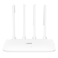
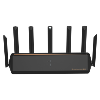
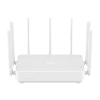
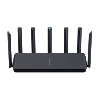
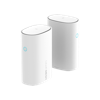

# MiWiFi for Home Assistant
[](https://github.com/hacs/integration)
[](https://github.com/dmamontov/hass-miwifi/actions?query=CodeQL)
[](https://t.me/hass_mamontov_tech)

The component allows you to monitor devices and manage routers based on [MiWiFi](http://miwifi.com/) from [Home Assistant](https://www.home-assistant.io/).

❗ Supports routers with original or original patched MiWifi firmware

❗ On the modified firmware, not all functionality may work

## More info
- [Install](https://github.com/dmamontov/hass-miwifi/wiki/Install)
- [Config](https://github.com/dmamontov/hass-miwifi/wiki/Config)
  - [Advanced config](https://github.com/dmamontov/hass-miwifi/wiki/Config#advanced-config)
    - [Automatically remove devices](https://github.com/dmamontov/hass-miwifi/wiki/Config#automatically-remove-devices)
- [Supported routers](https://github.com/dmamontov/hass-miwifi/wiki/Supported-routers)
  - [Check list](https://github.com/dmamontov/hass-miwifi/wiki/Supported-routers#check-list)
    - [Required](https://github.com/dmamontov/hass-miwifi/wiki/Supported-routers#required)
    - [Additional](https://github.com/dmamontov/hass-miwifi/wiki/Supported-routers#additional)
    - [Action](https://github.com/dmamontov/hass-miwifi/wiki/Supported-routers#action)
  - [Summary](https://github.com/dmamontov/hass-miwifi/wiki/Supported-routers#summary)
- [Conflicts](https://github.com/dmamontov/hass-miwifi/wiki/Conflicts)
- [Entities](https://github.com/dmamontov/hass-miwifi/wiki/Entities)
- [Services](https://github.com/dmamontov/hass-miwifi/wiki/Services)
  - [Calculate passwd](https://github.com/dmamontov/hass-miwifi/wiki/Services#calculate-passwd)
  - [Send request](https://github.com/dmamontov/hass-miwifi/wiki/Services#send-request)
- [Events](https://github.com/dmamontov/hass-miwifi/wiki/Events)
  - [Luci response](https://github.com/dmamontov/hass-miwifi/wiki/Events#luci-response)
- [Performance table](https://github.com/dmamontov/hass-miwifi/wiki/Performance-table)
- [Example automation](https://github.com/dmamontov/hass-miwifi/wiki/Example-automation)
  - [Device blocking](https://github.com/dmamontov/hass-miwifi/wiki/Example-automation#device-blocking)
  - [Lighting automation](https://github.com/dmamontov/hass-miwifi/wiki/Example-automation#lighting-automation)
- [Diagnostics](https://github.com/dmamontov/hass-miwifi/wiki/Diagnostics)
- [FAQ](https://github.com/dmamontov/hass-miwifi/wiki/FAQ)

## Home Assistant compatibility

- CI compatibility target: `>=2022.4.0`
- Forward-compatibility target: Home Assistant `dev` is also checked in CI
- In practice, the integration is maintained to keep working on current stable Home Assistant releases while preserving compatibility with older supported APIs where possible

The exact source of truth for this policy is the GitHub workflow configuration in [.github/workflows/checks.yml](.github/workflows/checks.yml) and [.github/workflows/dev_checks.yml](.github/workflows/dev_checks.yml).

## Debug logging

To enable debug logs for this integration, add the following to your `configuration.yaml`:

```yaml
logger:
  default: info
  logs:
    custom_components.miwifi: debug
```

Then restart Home Assistant and check `Settings -> System -> Logs`.

When debug logging is enabled, the integration logs the LuCI requests and responses for the API methods it actually calls. This is useful for troubleshooting unsupported routers, investigating missing attributes, and implementing new features.

Important: debug logging does not automatically dump every LuCI endpoint exposed by the router. It only logs the endpoints that the integration is currently using. To inspect additional endpoints, use the `miwifi.send_request` service and review the response event/logs.

## Lifecycle flow

### How setup works

1. Config flow verifies credentials with a minimal login + `xqsystem/init_info` check.
2. `async_setup_entry` creates a `LuciUpdater`, stores it in `hass.data`, and runs the first refresh with a longer setup timeout.
3. The first refresh walks the ordered preparation pipeline in `updater.py` to collect router state, optional capabilities, and device data.
4. If the first refresh succeeds, Home Assistant forwards platform setup for sensors, switches, buttons, lights, update entities, and device trackers.
5. If setup fails, the integration now creates a persistent notification with the error message and a collapsible traceback block so the first failure is visible in the UI.

### How refresh works

- Normal polling uses `DataUpdateCoordinator` with the configured scan interval.
- The updater logs in when needed, refreshes data in a fixed order, and then updates coordinator entities from the aggregated state.
- Optional LuCI probes such as VPN status, WAN info, LED state, Wi-Fi details, and mode probing are tolerated when a router does not support them or times out during setup.
- Device cleanup runs after refresh and removes only devices that have been inactive longer than the configured retention window.

### How device tracking works

- `xqnetwork/wifi_connect_devices` contributes signal strength and a fast list of connected Wi-Fi MAC addresses.
- `misystem/devicelist` contributes richer client metadata such as IP address, speeds, online duration, and the parent access point.
- The integration merges both responses into a single device cache and lazily creates new tracker entities when a new MAC appears.
- When multiple MiWiFi routers are configured, child devices can be reassigned to the updater that owns the parent router so each Home Assistant entry keeps the correct clients.

### How first refresh differs from normal polling

- First refresh can restore previously known devices from storage, discover child mesh routers, and build entity inventory.
- Reloads use a small delay before platform forwarding to let router state settle after authentication and discovery work.
- Config flow validation uses the same updater class, but only runs the minimal `init` probe so validation stays fast and predictable.

### Why some endpoints are optional

MiWiFi firmware varies a lot between models, regions, and patched builds. The integration treats core endpoints such as login, init info, and status as required, while best-effort probes are skipped when unsupported or temporarily cancelled. That keeps setup resilient on newer Home Assistant versions and on routers with incomplete LuCI APIs.

## Supported routers

Many more Xiaomi and Redmi routers supported by MiWiFi

### Check list

##### Required
- `xqsystem/login` - Authorization;
- `xqsystem/init_info` - Basic information about the router;
- `misystem/status` - Basic information about the router. Diagnostic data, memory, temperature, etc;
- `xqnetwork/mode` - Operating mode. Repeater, Access Point, Mesh, etc.

##### Additional
- `misystem/topo_graph` - Topography, auto discovery does not work without it;
- `xqsystem/check_rom_update` - Getting information about a firmware update;
- `xqnetwork/wan_info` - WAN port information;
- `xqsystem/vpn_status` - Information about vpn connection;
- `misystem/led` - Interaction with LEDs;
- `xqnetwork/wifi_detail_all` - Getting information about WiFi adapters;
- `xqnetwork/wifi_diag_detail_all` - Getting information about guest WiFi;
- `xqnetwork/avaliable_channels` - Gets available channels for WiFi adapter;
- `xqnetwork/wifi_connect_devices` - Get information about connected devices;
- `misystem/devicelist` - More information about connected devices;
- `xqnetwork/wifiap_signal` - AP signal in repeater mode;
- `misystem/newstatus` - Additional information about connected devices for force load mode.

##### Action
- `xqsystem/reboot` - Reboot;
- `xqsystem/upgrade_rom` - Firmware update;
- `xqsystem/flash_permission` - Clear permission. Required only for firmware updates;
- `xqnetwork/set_wifi` - Update WiFi settings. Causes the adapter to reboot;
- `xqnetwork/set_wifi_without_restart` - Update Guest WiFi settings.

❗ If your router is not listed or not tested, try adding an integration, it will check everything and give a link to create an issue. You just have to click `Submit new issue`

❗ If at the time of adding the integration only `Router {ip} not supported` message is displayed, please create an issue with the message that the router is not supported, indicating the model of the router.

### Summary

- 🟢 - Supported
- 🔴 - Not supported
- ⚪ - Not tested

| Image                  | Router                                |  Code  |      Required       |             Additional              |         Action          |
|------------------------|---------------------------------------|:------:|:-------------------:|:-----------------------------------:|:-----------------------:|
|  | **Xiaomi 5G CPE Pro**                 | CB0401  | <sub>🟢🟢🟢🟢</sub> | <sub>🟢🟢🟢🟢🟢🟢🟢🟢🟢🟢🟢🟢</sub> |  <sub>🟢🟢🟢🟢🟢</sub>  |
|   | **Mi Router 4A Gigabit V2**           | R4AV2  | <sub>🟢🟢🟢🟢</sub> | <sub>🟢🟢🟢🟢🟢🟢🟢🟢🟢🟢🟢🟢</sub> |  <sub>🟢🟢🟢🟢🟢</sub>  |
|    | **Xiaomi Home WiFi**                  |  RB08  | <sub>🟢🟢🟢🟢</sub> | <sub>🟢🟢🟢🟢🟢🟢🟢🟢🟢🟢🟢🟢</sub> |  <sub>🟢🟢🟢🟢🟢</sub>  |
|    | **Redmi Router AX6000**               |  RB06  | <sub>🟢🟢🟢🟢</sub> | <sub>🟢🟢🟢🟢🟢🟢🟢🟢🟢🟢🟢🟢</sub> |  <sub>🟢🟢🟢🟢🟢</sub>  |
|    | **Redmi Router AX5400**               |  RA74  | <sub>🟢🟢🟢🟢</sub> | <sub>🟢🟢🟢🟢🟢🟢🟢🟢🟢🟢🟢🟢</sub> |  <sub>🟢🟢🟢🟢🟢</sub>  |
|    | **Redmi Gaming Router AX5400**        |  RB04  | <sub>🟢🟢🟢🟢</sub> | <sub>🟢🟢⚪🟢🟢🟢🟢🟢🟢🟢🟢🟢</sub> |  <sub>🟢⚪🟢🟢🟢</sub>   |
|    | **Xiaomi Router AC1200**              |  RB02  | <sub>🟢🟢🟢🟢</sub> | <sub>🟢🟢🟢🟢🟢🟢🟢🟢🟢🟢🟢🟢</sub> |  <sub>🟢🟢🟢🟢🟢</sub>  |
|  | **Xiaomi Router CR8808**              | CR8808 | <sub>🟢🟢🟢🟢</sub> | <sub>🟢🟢🟢🟢🟢🟢🟢🟢🟢🟢🟢🟢</sub> |  <sub>🟢🟢🟢🟢🟢</sub>  |
|    | **Xiaomi Mesh System AX3000**         |  RA82  | <sub>🟢🟢🟢🟢</sub> | <sub>🟢🟢🟢🟢🟢🟢🟢🟢🟢🟢🟢🟢</sub> |  <sub>🟢🟢🟢🟢🟢</sub>  |
|    | **Xiaomi Router AX3200**              |  RB01  | <sub>🟢🟢🟢🟢</sub> | <sub>🟢🟢🟢🟢🟢🟢🟢🟢🟢🟢🟢🟢</sub> |  <sub>🟢🟢🟢🟢🟢</sub>  |
|    | **Redmi Router AX1800**               |  RA71  | <sub>🟢🟢🟢🟢</sub> | <sub>🟢🟢🟢🟢🟢🟢🟢🟢🟢🟢🟢🟢</sub> |  <sub>🟢🟢🟢🟢🟢</sub>  |
|    | **Redmi Router AX6S**                 |  RB03  | <sub>🟢🟢🟢🟢</sub> | <sub>🟢🟢🟢🟢🟢🟢🟢🟢🟢🟢🟢🟢</sub> |  <sub>🟢🟢🟢🟢🟢</sub>  |
|    | **Xiaomi Router AX3000**              |  RA80  | <sub>🟢🟢🟢🟢</sub> | <sub>🟢🟢🟢🟢🟢🟢🟢🟢🟢🟢🟢🟢</sub> |  <sub>🟢🟢🟢🟢🟢</sub>  |
|    | **Redmi Router AX3000**               |  RA81  | <sub>🟢🟢🟢🟢</sub> | <sub>🟢🟢🟢🟢🟢🟢🟢🟢🟢🟢🟢🟢</sub> |  <sub>🟢🟢🟢🟢🟢</sub>  |
|  | **Xiaomi China Unicom WiFi 6 Router** | CR6606 | <sub>🟢🟢🟢🟢</sub> | <sub>🟢🟢🟢🟢🟢🟢🟢🟢🟢🟢🟢🟢</sub> |  <sub>🟢🟢🟢🟢🟢</sub>  |
|    | **Xiaomi Router AX9000**              |  RA70  | <sub>🟢🟢🟢🟢</sub> | <sub>🟢🟢🟢🟢🟢🟢🟢🟢🟢🟢🟢🟢</sub> |  <sub>🟢🟢🟢🟢🟢</sub>  |
|    | **Redmi Router AX5**                  |  RA50  | <sub>🟢🟢🟢🟢</sub> | <sub>🟢🟢🟢🟢🟢🟢🟢🟢🟢🟢🟢🟢</sub> |  <sub>🟢🟢🟢🟢🟢</sub>  |
|    | **Xiaomi Router AX6000**              |  RA72  | <sub>🟢🟢🟢🟢</sub> | <sub>🟢🟢🟢🟢🟢🟢🟢🟢🟢🟢🟢🟢</sub> |  <sub>🟢🟢🟢🟢🟢</sub>  |
|    | **Redmi Router AX6**                  |  RA69  | <sub>🟢🟢🟢🟢</sub> | <sub>🟢🟢🟢🟢🟢🟢🟢🟢🟢🟢🟢🟢</sub> |  <sub>🟢🟢🟢🟢🟢</sub>  |
|   | **Mi Router 4 Pro**                   | R1350  | <sub>🟢🟢🟢🟢</sub> | <sub>🟢🟢🟢🟢🟢🟢🟢🟢🟢🟢🟢🟢</sub> |  <sub>🟢🟢🟢🟢🟢</sub>  |
|   | **Mi AIoT Router AC2350**             | R2350  | <sub>🟢🟢🟢🟢</sub> | <sub>🟢🟢🟢🟢🟢🟢🟢🟢🟢🟢🟢🟢</sub> |  <sub>🟢🟢🟢🟢🟢</sub>  |
|    | **Redmi Router AX5**                  |  RA67  | <sub>🟢🟢🟢🟢</sub> | <sub>🟢🟢🟢🟢🟢🟢🟢🟢🟢🟢🟢🟢</sub> |  <sub>🟢🟢🟢🟢🟢</sub>  |
|  | **Mi Router AX1800**                  | RM1800 | <sub>🟢🟢🟢🟢</sub> | <sub>🟢🟢🟢🟢🟢🟢🟢🟢🟢🟢🟢🟢</sub> |  <sub>🟢🟢🟢🟢🟢</sub>  |
|   | **Xiaomi AIoT Router AX3600**         | R3600  | <sub>🟢🟢🟢🟢</sub> | <sub>🟢🟢🟢🟢🟢🟢🟢🟢🟢🟢🟢🟢</sub> |  <sub>🟢🟢🟢🟢🟢</sub>  |
|  | **Redmi Router AC2100**               | RM2100 | <sub>🟢🟢🟢🟢</sub> | <sub>🟢🟢🟢🟢🟢🟢🟢🟢🟢🟢🟢🟢</sub> |  <sub>🟢🟢🟢🟢🟢</sub>  |
|   | **Mi Router AC2100**                  | R2100  | <sub>🟢🟢🟢🟢</sub> | <sub>🟢🟢🟢🟢🟢🟢🟢🟢🟢🟢🟢🟢</sub> |  <sub>🟢🟢🟢🟢🟢</sub>  |
|     | **Mi Router Mesh**                    |  D01   | <sub>🟢🟢🟢🟢</sub> | <sub>🟢🟢🟢🟢🟢🟢🟢🟢🟢🟢🟢🔴</sub> |  <sub>🟢🟢🟢🟢🟢</sub>  |
|    | **Mi Router 4A**                      |  R4AC  | <sub>🟢🟢🟢🟢</sub> | <sub>🟢🟢🟢🟢🟢🟢🟢🟢🟢🟢🟢🔴</sub> |  <sub>🟢🟢🟢🟢🟢</sub>  |
|     | **Mi Router 4A Gigabit**              |  R4A   | <sub>🟢🟢🟢🟢</sub> | <sub>🟢🟢🟢🟢🟢🟢🟢🟢🟢🟢🟢🔴</sub> |  <sub>🟢🟢🟢🟢🟢</sub>  |
|    | **Mi Router 4C**                      |  R4CM  | <sub>🟢🟢🟢🟢</sub> | <sub>🟢🟢🟢🟢🟢🟢🟢🟢🟢🟢🟢🔴</sub> |  <sub>🟢🟢🟢🟢🟢</sub>  |
|     | **Mi Router 4Q**                      |  R4C   | <sub>🟢🟢🟢🟢</sub> | <sub>🟢🟢🟢🟢🟢🟢🟢🟢🟢🟢🟢🔴</sub> |  <sub>🟢🟢🟢🟢🟢</sub>  |
|      | **Mi Router 4**                       |   R4   | <sub>🟢🟢🟢🟢</sub> | <sub>🟢🟢🟢🟢🟢🟢🟢🟢🟢🟢🟢🔴</sub> |  <sub>🟢🟢🟢🟢🟢</sub>  |
|     | **Mi Router 3A**                      |  R3A   | <sub>🟢🟢🟢🟢</sub> | <sub>🟢🟢🟢🟢🟢🟢🟢🟢🟢🟢🟢🔴</sub> |  <sub>🟢🟢🟢🟢🟢</sub>  |
|     | **Mi Router 3C**                      |  R3L   | <sub>🟢🟢🟢🟢</sub> | <sub>🟢🟢🟢🟢🟢🟢🟢🟢🟢🟢🟢🔴</sub> |  <sub>🟢🟢🟢🟢🟢</sub>  |
|     | **Mi Router HD**                      |  R3D   | <sub>🟢🟢🟢🟢</sub> | <sub>🟢🟢🟢🟢🟢🟢🟢🟢🟢🟢🟢🔴</sub> |  <sub>🟢🟢🟢🟢🟢</sub>  |
|     | **Mi Router Pro**                     |  R3P   | <sub>🟢🟢🟢🟢</sub> | <sub>🟢🟢🟢🟢🟢🟢🟢🟢🟢🟢🟢🔴</sub> |  <sub>🟢🟢🟢🟢🟢</sub>  |
|     | **Mi Router 3G**                      |  R3G   | <sub>🟢🟢🟢🟢</sub> | <sub>🟢🟢🟢🟢🟢🟢🟢🟢🟢🟢🟢🔴</sub> |  <sub>🟢🟢🟢🟢🟢</sub>  |
|      | **Mi Router 3**                       |   R3   | <sub>🟢🟢🟢🟢</sub> | <sub>🟢🟢🟢🟢🟢🟢🟢🟢🟢🟢🟢🔴</sub> |  <sub>🟢🟢🟢🟢🟢</sub>  |
|     | **Mi Router R2D**                     |  R2D   | <sub>🟢🟢🟢🟢</sub> | <sub>🟢🟢🟢🟢🟢🟢🟢🟢🟢🟢🟢🔴</sub> |  <sub>🟢🟢🟢🟢🟢</sub>  |
|    | **Mi Router Lite**                    |  R1CL  | <sub>🟢🟢🟢🟢</sub> | <sub>🟢🟢🟢🟢🟢🟢🟢🟢🟢🟢🟢🔴</sub> |  <sub>🟢🟢🟢🟢🟢</sub>  |
|     | **Mi Router Mini**                    |  R1CM  | <sub>🟢🟢🟢🟢</sub> | <sub>🟢🟢🟢🟢🟢🟢🟢🟢🟢🟢🟢🔴</sub> |  <sub>🟢🟢🟢🟢🟢</sub>  |
|     | **Mi Router R1D**                     |  R1D   | <sub>🟢🟢🟢🟢</sub> | <sub>🟢🟢🟢🟢🟢🟢🟢🟢🟢🟢🟢🔴</sub> |  <sub>🟢🟢🟢🟢🟢</sub>  |


